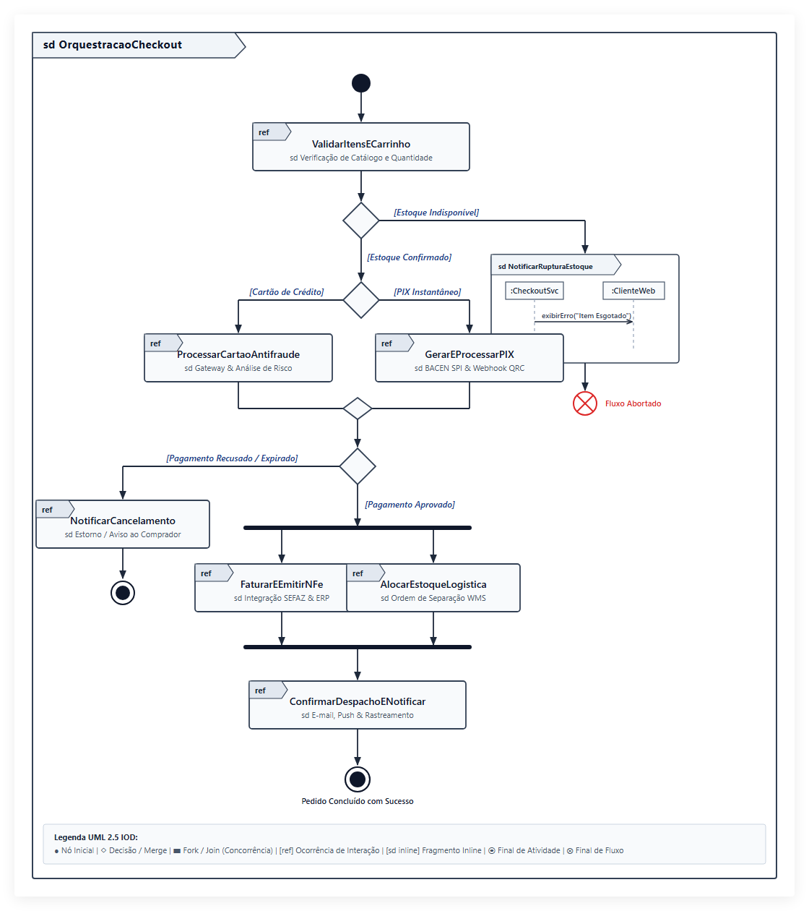

# Diagrama de Visão Geral de Interação

**Grupo 8:** Paulo, Augusto e Lucas

---

## Definição

O **Diagrama de Visão Geral de Interação** (*Interaction Overview Diagram* - IOD) é um dos 14 diagramas estruturados pela especificação **OMG UML 2.x**, classificado formalmente na categoria de **Diagramas Comportamentais de Interação**.

Trata-se de uma especialização direta do **Diagrama de Atividades**, combinada semanticamente com os conceitos do **Diagrama de Sequência**. Enquanto o Diagrama de Atividades tradicional conecta nós de ação atômicos (`OpaqueAction`), o Diagrama de Visão Geral de Interação conecta **ocorrências de interação** (*Interaction Use* com o operador `ref`) ou **fragmentos de interação inline** (*Interaction Occurrence*). 

Seu objetivo primordial é fornecer uma **visão macroscópica (*bird's-eye view*)** da orquestração de múltiplos fluxos e cenários de um sistema. Ele soluciona um dos principais desafios da engenharia de software: quando um fluxo de negócio envolve ramificações complexas, laços de repetição, caminhos de exceção e chamadas concorrentes, um único Diagrama de Sequência torna-se excessivamente longo, ilegível e difícil de manter. O Diagrama de Visão Geral de Interação atua como a "planta mestre", demonstrando como os diagramas de sequência modulares se encadeiam por meio de nós de controle e lógica de fluxo.

---

## Quando usar

O Diagrama de Visão Geral de Interação é especialmente valioso nas fases de **Análise Detalhada**, **Design Arquitetural** e **Documentação Técnica** de sistemas corporativos de média e alta complexidade:

1. **Orquestração de Cenários de Casos de Uso Complexos:** Quando um Caso de Uso possui múltiplos fluxos alternativos e de exceção que exigiriam dezenas de páginas de diagramas de sequência isolados, o IOD serve como mapa de navegação unificado.
2. **Arquitetura de Microsserviços e Sistemas Distribuídos:** Na modelagem de sagas, coreografias ou orquestrações entre múltiplos serviços autônomos, permitindo visualizar a ordem temporal e as condições de transição entre cada subprocesso transacional.
3. **Sistemas com Regras de Negócio Críticas e Bifurcações:** Em fluxos como pagamentos online, emissão de faturamento, autenticação multifator (MFA) e pipelines de dados, onde a visualização de decisões de roteamento e paralelismo é essencial.
4. **Comunicação entre Arquitetos, Desenvolvedores e Stakeholders:** Facilita a comunicação executiva com desenvolvedores sêniores e analistas, permitindo que a equipe compreenda a visão geral antes de inspecionar a troca minuciosa de mensagens em cada diagrama de sequência.

---

## Elementos da notação

A notação do Diagrama de Visão Geral de Interação herda a sintaxe de nós de controle dos Diagramas de Atividades da UML 2 e agrega os delimitadores de interação:

| Símbolo | Nome | O que representa |
|---|---|---|
| `frame (sd ...)` | **Quadro Delimitador (*Frame*)** | Retângulo externo que encapsula todo o diagrama. Possui um pentágono no canto superior esquerdo com o prefixo `sd` (*sequence diagram/interaction*) seguido do nome do fluxo macro modelado. |
| `ref` | **Uso de Interação (*Interaction Use / ref*)** | Retângulo que representa uma referência a outro diagrama de interação (normalmente um Diagrama de Sequência) documentado separadamente. Possui a palavra-chave `ref` no canto superior esquerdo e o nome da interação referenciada ao centro. |
| *(Quadro com Lifelines)* | **Interação Inline (*Inline Interaction*)** | Fragmento de interação desenhado diretamente dentro de um nó do fluxo. Útil para pequenas trocas de mensagens locais que não justificam a criação de um diagrama de sequência à parte. |
| `●` | **Nó Inicial (*Initial Node*)** | Círculo sólido preto que indica o ponto de entrada e inicialização da execução do fluxo de interação. |
| `◇` | **Nó de Decisão (*Decision Node*)** | Losango simples que bifurca o fluxo de controle em dois ou mais caminhos mutuamente exclusivos, com base em condições de guarda booleanas `[condição]`. |
| `◇` | **Nó de Junção/Mesclagem (*Merge Node*)** | Losango simples que une múltiplos caminhos alternativos que chegam em um único fluxo de saída, sem sincronização temporal. |
| `▬` / `❚` | **Nó de Bifurcação Concorrente (*Fork Node*)** | Barra horizontal ou vertical espessa que divide um fluxo de controle único em dois ou mais fluxos executados concorrentemente (em paralelo). |
| `▬` / `❚` | **Nó de União Sincronizada (*Join Node*)** | Barra espessa que sincroniza múltiplos fluxos concorrentes. O fluxo subsequente só é disparado quando todos os fluxos de entrada tiverem concluído sua execução. |
| `──▶` | **Fluxo de Controle (*Control Flow*)** | Linha contínua com ponta de seta aberta indicando a passagem de controle entre uma ocorrência de interação e a próxima. Pode conter guardas textuais entre colchetes (`[guarda]`). |
| `[ ]` | **Condição de Guarda (*Guard Condition*)** | Expressão booleana delimitada por colchetes posicionada sobre uma aresta de controle de saída de um nó de decisão (ex: `[Pagamento Aprovado]`). |
| `⨂` | **Nó Final de Fluxo (*Flow Final Node*)** | Círculo com um "X" interno indicando o término de um caminho concorrente específico, sem encerrar o diagrama por completo. |
| `⦿` | **Nó Final de Atividade (*Activity Final Node*)** | Círculo sólido envolvido por um círculo externo (alvo/bullseye) que indica o encerramento absoluto e completo de todo o fluxo de interação. |

---

## Exemplo prático

### Cenário: Orquestração do Processamento de Pedido e Pagamento em E-Commerce

O exemplo modelado representa o **Processamento Transacional de um Pedido de E-Commerce**, orquestrado pelo serviço de checkout. O diagrama conecta módulos desacoplados de interação e ilustra decisões condicionais, tratamento de falhas e paralelismo:

1. **Início do Fluxo:** O controle tem início no *Nó Inicial* e avança imediatamente para a interação referenciada `ref ValidarCarrinhoEEstoque`.
2. **Decisão de Validação:** Um nó de decisão avalia a disponibilidade dos itens:
   - Se `[Estoque Indisponível]`, o controle é desviado para a interação inline `Notificar Falha de Estoque` e o fluxo é encerrado sem cobrança.
   - Se `[Estoque Válido]`, o fluxo prossegue para a seleção do meio de pagamento.
3. **Bifurcação de Método de Pagamento:** Uma decisão direciona o fluxo conforme a modalidade escolhida pelo comprador:
   - `[Cartão de Crédito]`: Executa o diagrama de sequência referenciado `ref ProcessarCartaoAntifraude`.
   - `[PIX]`: Executa o diagrama de sequência referenciado `ref GerarEPagarPIX`.
4. **Mesclagem e Avaliação do Pagamento:** Os fluxos convergem em um *Merge Node*. Em seguida, um novo nó de decisão inspeciona o status:
   - Se `[Pagamento Recusado/Expirado]`, executa `ref NotificarCancelamento` e encerra.
   - Se `[Pagamento Confirmado]`, o fluxo atinge uma barra de paralelismo (*Fork Node*).
5. **Execução Paralela (Fork/Join):** Duas operações críticas são disparadas simultaneamente:
   - Ramo 1: `ref FaturarEEmitirNFe` (comunicação com a SEFAZ e ERP contábil).
   - Ramo 2: `ref SepararEstoqueLogistica` (reserva física no WMS).
6. **Sincronização e Conclusão:** Os dois fluxos paralelos unem-se em uma barra de sincronização (*Join Node*). Após a garantia de que a NF foi emitida e o estoque reservado, a interação `ref DespacharPedidoENotificar` é acionada e o ciclo atinge o *Nó Final de Atividade*.

---

## Comparação com Caso de Uso, Classe e Sequência

A tabela e os tópicos abaixo consolidam as diferenças conceituais e estruturais do Diagrama de Visão Geral de Interação em relação aos diagramas clássicos estudados:

| Critério | Diagrama de Caso de Uso | Diagrama de Classe | Diagrama de Sequência | Diagrama de Visão Geral de Interação |
|---|---|---|---|---|
| **Classificação UML** | Comportamental | Estrutural | Comportamental (Interação) | Comportamental (Interação / Atividade) |
| **Perspectiva** | Visão externa e funcional (atores e objetivos do negócio). | Visão estática e estrutural (classes, atributos, métodos e relações). | Visão dinâmica microscópica (ordem temporal de mensagens entre objetos). | Visão dinâmica macroscópica (orquestração lógica entre múltiplos cenários). |
| **Foco Principal** | *O que* o sistema faz para o usuário. | *Como* o sistema é construído internamente. | *Qual a troca exata de mensagens* em um cenário linear. | *Como múltiplos cenários* se conectam através de decisões e loops. |
| **Tratamento de Lógica/Decisão** | Não detalha fluxos internos ou condicionais complexas. | Não possui conceito de tempo ou fluxo de controle de execução. | Permite fragmentos (`alt`, `opt`, `loop`), mas torna-se ilegível se houver muitos. | **Excelente:** utiliza nós de decisão, forks, joins e merges nativos da UML. |
| **Relação com o IOD** | O IOD pode detalhar a implementação completa de um Caso de Uso complexo. | O IOD referencia sequências cujas mensagens invocam métodos das Classes. | Os diagramas de sequência são os blocos construtores (`ref`) que o IOD organiza. | **É a ponte** que integra a visão de processo (atividades) com a visão de troca de mensagens. |

### Diferenças e Semelhanças em Detalhe:
- **Vs. Diagrama de Sequência:** O Diagrama de Sequência brilha ao detalhar a troca de mensagens, linhas de vida (*lifelines*) e ativações entre objetos específicos com precisão cirúrgica de tempo. No entanto, representar fluxos com dezenas de alternativas e laços no Diagrama de Sequência torna os quadros `alt` e `loop` aninhados e confusos. O IOD extrai cada ramo para um sub-diagrama modular (`ref`) e cuida apenas do roteamento de controle.
- **Vs. Diagrama de Atividades:** O IOD herda toda a máquina de fluxo de controle do Diagrama de Atividades (nós, guardas, sincronizações). A diferença fundamental é semântica: enquanto as atividades manipulam ações e objetos de dados, o IOD manipula **interações e comportamentos colaborativos**.
- **Vs. Diagrama de Caso de Uso:** O Caso de Uso estabelece as fronteiras do sistema e as intenções dos atores sem especificar a mecânica computacional. O IOD pega essa intenção e detalha operacionalmente a coreografia de serviços necessária para completá-la.

---

## Apresentação

O arquivo da apresentação com a fundamentação teórica, exemplos da indústria e análise da especificação OMG encontra-se disponível no link abaixo:

- [Apresentação em PDF](apresentacao.pdf)

---

## Referências

- **OBJECT MANAGEMENT GROUP (OMG).** *Unified Modeling Language (OMG UML) Specification, Version 2.5.1*. Seção 17.3: *Interaction Overview Diagrams*, 2017. Disponível em: <https://www.omg.org/spec/UML/2.5.1/>.
- **FOWLER, Martin.** *UML Essencial: Um Guia Conciso para a Linguagem-Padrão de Modelagem de Objetos*. 3. ed. Porto Alegre: Bookman, 2005.
- **LARMAN, Craig.** *Utilizando UML e Padrões: Uma Introdução à Análise e ao Projeto Orientados a Objetos e ao Desenvolvimento Iterativo*. 3. ed. Porto Alegre: Bookman, 2007.
- **BOOCH, Grady; RUMBAUGH, James; JACOBSON, Ivar.** *UML: Guia do Usuário*. 2. ed. Rio de Janeiro: Campus/Elsevier, 2006.
- **BELL, Donald.** *UML basics: The interaction overview diagram*. IBM Developer, 2004. Disponível em: <https://developer.ibm.com/articles/the-interaction-overview-diagram/>.
